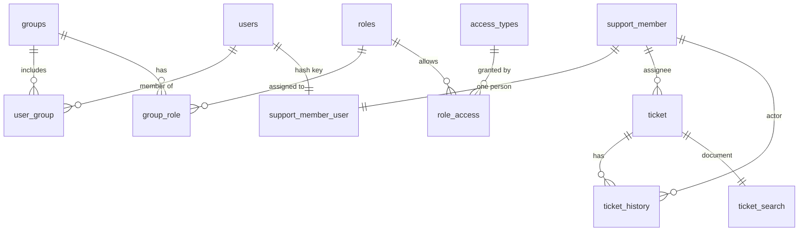

# Data Model: WeSolve Platform

PostgreSQL 17 with the `pgvector` extension. Every change is a Flyway migration. Names are `snake_case`.

## Changes to the structure proposed earlier

| Earlier proposal | Now | Why |
|---|---|---|
| `ticket_comment` table | Removed. Comments live on `ticket_history` rows | Spec 008: one history record holds state changes and comments |
| `support_member.active` | `support_member.assignable` | Spec 010 separates "active" (can sign in) from "can be assigned tickets" |
| `access_types.id` | `access_types.code` is the key | The list of nine actions is fixed |
| Sequence-based watermark | Counter row (`audit_watermark`) | A sequence is not commit-ordered and has gaps (research R6) |
| Eight action codes | Nine (`USER_MANAGE` added) | Spec 010 separates Manage users from Manage access |

## Entity relationships

## Audit columns

Every audited table carries `created_at timestamptz`, `created_by varchar(64)`, `updated_at timestamptz`, `updated_by varchar(64)`, and `last_watermark bigint`. Join tables and `ticket_history` carry only `created_at`, `created_by`, `last_watermark` because rows are never updated. `created_by` and `updated_by` hold the acting person's hash key, or `system`. All are set by the audit trigger; the application never writes them.

## Access tables

### `users`

| Column | Type | Rules |
|---|---|---|
| id | uuid | PK, default `gen_random_uuid()` |
| hash_key | varchar(64) | Unique, not null, `^[0-9a-f]{64}$`, immutable. SHA-256 of the lower-cased sign-in id |
| sign_in_id | varchar(100) | Unique, not null, stored lower-case, immutable (trigger) |
| display_name | varchar(100) | Not null, not blank |
| email | varchar(254) | Unique, not null, stored lower-case, must match `.+@.+` |
| active | boolean | Not null, default true |
| can_be_assigned | boolean | Not null, default true |

Indexes: unique on `hash_key`, `sign_in_id`, `email`; trigram or `lower(display_name)` index for the user search.

### `groups`, `roles`

| Column | Type | Rules |
|---|---|---|
| id | uuid | PK |
| name | varchar(100) | Unique (case-insensitive), not blank |
| active | boolean | `groups` only. Default true. An inactive group grants nothing |

### `access_types`

| Column | Type | Rules |
|---|---|---|
| code | varchar(40) | PK, one of the nine codes below |
| description | varchar(200) | Display text for the Access screen |

### Join tables

| Table | Key | References |
|---|---|---|
| `user_group` | (`user_hash_key`, `group_id`) | `users.hash_key`, `groups.id` |
| `group_role` | (`group_id`, `role_id`) | `groups.id`, `roles.id` |
| `role_access` | (`role_id`, `access_code`) | `roles.id`, `access_types.code` |

Each has an index on its second key column so reverse lookups do not scan.

### Effective actions

A person's actions are the distinct `access_code` values reached through `user_group` -> `group_role` -> `role_access`, counting only `groups.active = true` and `users.active = true`. That is the only place access is granted.

### Seed data (migration `V7`)

| Access code | Display text |
|---|---|
| TICKET_CREATE | Create tickets |
| TICKET_VIEW | View tickets |
| TICKET_UPDATE | Update tickets |
| TICKET_STATUS | Change ticket status |
| TICKET_COMMENT | Comment on tickets |
| TICKET_SEARCH | Search tickets |
| TICKET_ASSISTANT | Use the assistant |
| USER_MANAGE | Manage users |
| ACCESS_MANAGE | Manage access |

| Group | Role | Actions |
|---|---|---|
| Support | Support agent | the seven `TICKET_*` codes |
| User managers | User manager | `USER_MANAGE` |
| Administrators | Admin | `USER_MANAGE`, `ACCESS_MANAGE` |

Seed inserts use `ON CONFLICT DO NOTHING` so a second start never duplicates them.

## Member tables (the lightweight read path)

### `support_member`

| Column | Type | Rules |
|---|---|---|
| id | uuid | PK. Referenced by `ticket.assignee_id` and `ticket_history` |
| hash_key | varchar(64) | Unique, not null. The same value as `users.hash_key`. **No foreign key** |
| display_name | varchar(100) | Not null. Copy of `users.display_name` |
| assignable | boolean | Not null. `users.active AND users.can_be_assigned` |

### `support_member_user`

| Column | Type | Rules |
|---|---|---|
| support_member_id | uuid | PK, FK `support_member.id` |
| user_hash_key | varchar(64) | Unique, FK `users.hash_key` |

Every `users` row has exactly one `support_member` and one `support_member_user` row, created in the same transaction. When name, active, or can_be_assigned changes on `users`, the access module updates `support_member` in the same transaction. Ticket queue, ticket detail, history, and the dashboard read `support_member` only and never join `users`. Assignee choices read `support_member WHERE assignable`.

## Ticket tables

### `ticket`

| Column | Type | Rules |
|---|---|---|
| id | uuid | PK |
| ticket_number | bigint | Unique, not null, from `ticket_number_seq`, never reused, shown as `TKT-<n>` |
| title | varchar(150) | Not null, `btrim(title) <> ''` |
| description | varchar(5000) | Not null, `btrim(description) <> ''` |
| priority | varchar(10) | `LOW`, `MEDIUM`, `HIGH`, `URGENT` |
| status | varchar(12) | `OPEN`, `IN_PROGRESS`, `RESOLVED`, `CLOSED`, `CANCELLED`. Default `OPEN` |
| assignee_id | uuid | Not null, FK `support_member.id`, member must be `assignable` at the time of assignment |

Indexes: unique `ticket_number`; `(assignee_id, status, ticket_number DESC)` for the dashboard; `(status, ticket_number DESC)` for the status filter; `(ticket_number DESC)` for the queue.

**Status guard** (trigger on update of `status`): allowed only for the pairs below, plus a no-op update to the same value. Anything else raises an error. `updated_at` and `updated_by` move only when `title`, `description`, `priority`, `assignee_id`, or `status` actually changes.

| From | To |
|---|---|
| OPEN | IN_PROGRESS, CANCELLED |
| IN_PROGRESS | RESOLVED, CANCELLED |
| RESOLVED | CLOSED |
| CLOSED, CANCELLED | none |

### `ticket_history`

Insert-only. Update and delete are rejected by trigger.

| Column | Type | Rules |
|---|---|---|
| id | bigint | Identity PK. Oldest-first order is `id ASC` |
| ticket_id | uuid | Not null, FK `ticket.id` |
| actor_id | uuid | Not null, FK `support_member.id` |
| from_status | varchar(12) | Null unless the entry changes status |
| to_status | varchar(12) | Null unless the entry changes status. `OPEN` on the creation entry |
| from_assignee_id | uuid | Null on creation, otherwise set when the assignee changes |
| to_assignee_id | uuid | Set on creation and when the assignee changes |
| comment | varchar(2000) | Null or non-blank |

Check constraints:

- At least one of `to_status`, `to_assignee_id`, `comment` is not null.
- `to_status IN ('RESOLVED','CANCELLED')` requires a non-blank `comment`.
- `from_status` and `to_status` are both null or both set, except the creation entry where only `to_status` is set.
- `from_assignee_id` and `to_assignee_id` are both null or both set, except the creation entry where only `to_assignee_id` is set.

Entry kinds, derived by the API and not stored:

| Kind | Columns set |
|---|---|
| Created | `to_status = OPEN`, `to_assignee_id`, no `from_*` |
| Status change | `from_status`, `to_status`, optional `comment` |
| Assignment | `from_assignee_id`, `to_assignee_id`, optional `comment` |
| Status and assignment | all four, optional `comment` |
| Free comment | only `comment` |

Index: `(ticket_id, id)`.

## Derived tables (rebuildable, not audited)

### `ticket_search`

| Column | Type | Rules |
|---|---|---|
| ticket_id | uuid | PK, FK `ticket.id` |
| document | tsvector | `to_tsvector('simple', title || ' ' || description || ' ' || all comments)` |

GIN index on `document`. Triggers on `ticket` and `ticket_history` rebuild the row for one ticket. A comment insert does not change `ticket.updated_at`.

### `vector_store`

Created by migration, not by Spring AI (`initialize-schema=false`).

| Column | Type | Rules |
|---|---|---|
| id | uuid | PK, default `gen_random_uuid()` |
| content | text | Redacted text that was embedded |
| metadata | json | `ticketNumber`, `kind` (`TICKET` or `COMMENT`), `historyId` |
| embedding | vector(1536) | HNSW index, `vector_cosine_ops` |

### `embedding_task`

| Column | Type | Rules |
|---|---|---|
| id | bigint | Identity PK |
| ticket_id | uuid | Not null |
| history_id | bigint | Null for `TICKET` tasks |
| kind | varchar(10) | `TICKET` or `COMMENT` |
| status | varchar(10) | `PENDING`, `DONE`, `FAILED` |
| attempts | int | Default 0, `FAILED` after 5 |
| next_attempt_at | timestamptz | Backoff schedule |
| last_error | varchar(500) | Provider message without secrets |

Index: `(status, next_attempt_at)`. Rows are written in the same transaction as the ticket or history insert.

### `idempotency_record`

| Column | Type | Rules |
|---|---|---|
| actor_hash | varchar(64) | PK part |
| idempotency_key | varchar(100) | PK part |
| request_hash | varchar(64) | SHA-256 of method, path, and body |
| response_status | int | Replayed on a repeat |
| response_body | jsonb | Replayed on a repeat |
| created_at | timestamptz | Purged after 24 hours |

## Audit tables

### `audit_watermark`

One row (`id = 1`, `value bigint`). Each audited change runs `UPDATE audit_watermark SET value = value + 1 RETURNING value`. The row lock is held until commit, so watermarks are in commit order and have no gaps.

### `audit_change`

Insert-only. Update and delete are rejected by trigger.

| Column | Type | Rules |
|---|---|---|
| watermark | bigint | PK. Value taken from `audit_watermark` |
| changed_at | timestamptz | Transaction time |
| actor_hash | varchar(64) | From `app.actor`, or `system` |
| table_name | varchar(63) | Audited table |
| operation | varchar(6) | `INSERT`, `UPDATE`, `DELETE` |
| row_key | text | Primary key value; composite keys joined with `|` |
| before_data | jsonb | Null on insert |
| after_data | jsonb | Null on delete |
| transaction_id | bigint | `txid_current()` |

Index: `(table_name, row_key, watermark)`.

Audited tables: `users`, `groups`, `roles`, `access_types`, `user_group`, `group_role`, `role_access`, `support_member`, `support_member_user`, `ticket`, `ticket_history`.

Ticket status history is a view over `ticket_history`; the full before and after values of any row are in `audit_change`.

## Planned migrations

| Version | Content |
|---|---|
| V1 | Extensions (`vector`), `audit_watermark`, `audit_change`, trigger functions |
| V2 | `users`, `groups`, `roles`, `access_types`, join tables, audit triggers |
| V3 | `support_member`, `support_member_user`, sync constraints |
| V4 | `ticket_number_seq`, `ticket`, status guard, audit trigger |
| V5 | `ticket_history`, constraints, immutability and audit triggers |
| V6 | `ticket_search`, rebuild triggers, GIN index |
| V7 | Seed: access types, roles, groups, links |
| V8 | `idempotency_record` |
| V9 | `vector_store`, HNSW index, `embedding_task` |

The Flyway history table is the schema watermark.

## Validation rules mapped to specs

| Rule | Where it is enforced |
|---|---|
| Title 1-150, description 1-5,000, blank means only spaces | Bean Validation at the API, `CHECK` in the database |
| Priority from four values | Enum in the API, `CHECK` in the database |
| Assignee exists and is assignable | Service checks, FK in the database |
| Status path | Domain service and the database trigger |
| Comment required to resolve or cancel, at most 2,000 characters | Domain service, `CHECK` on `ticket_history` |
| History and audit cannot change | Triggers |
| Sign-in id never changes | Trigger on `users` |
| At least one active holder of `ACCESS_MANAGE` | Service check inside the same transaction, under a row lock on the affected groups |
